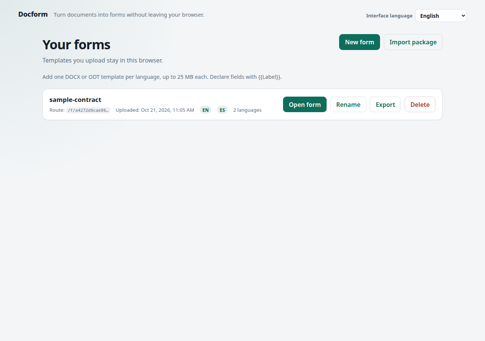
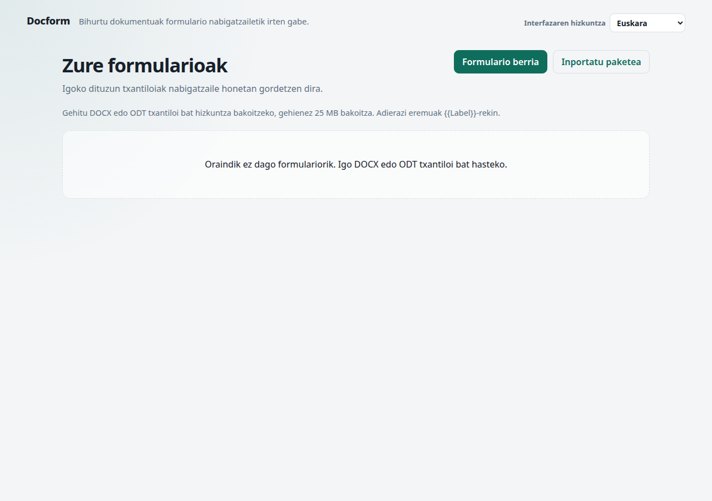
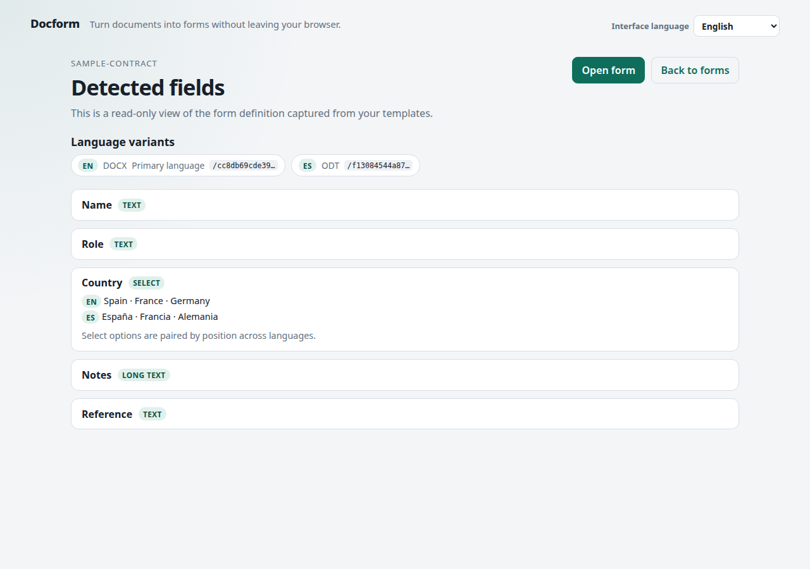
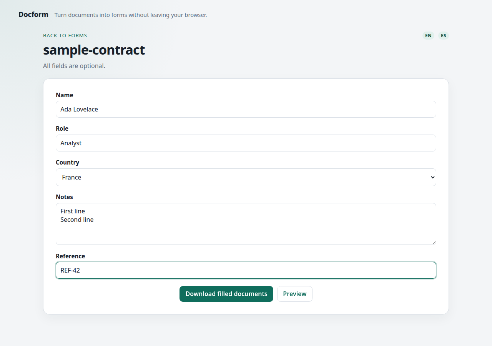
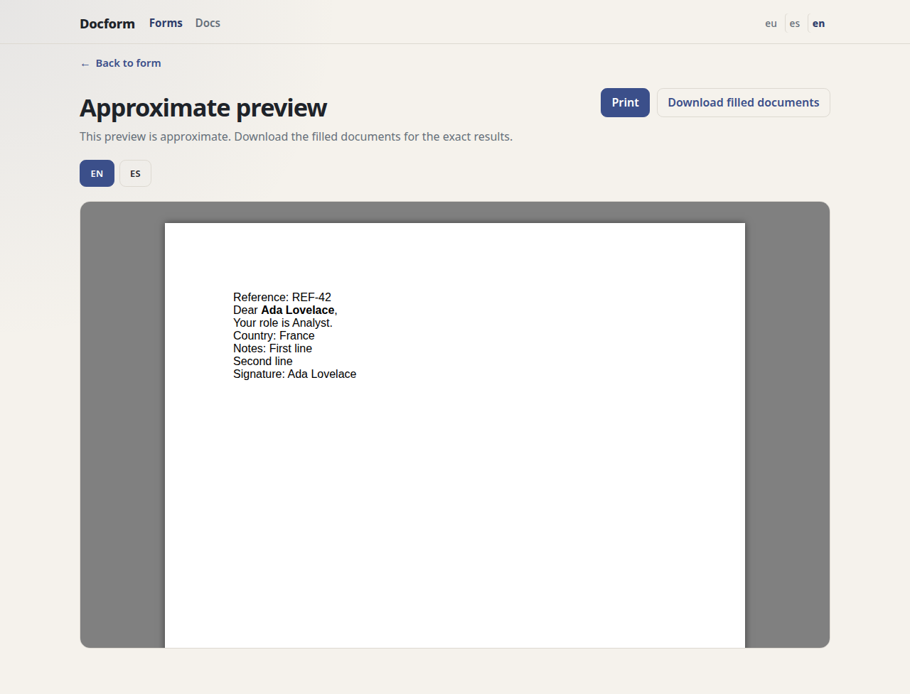
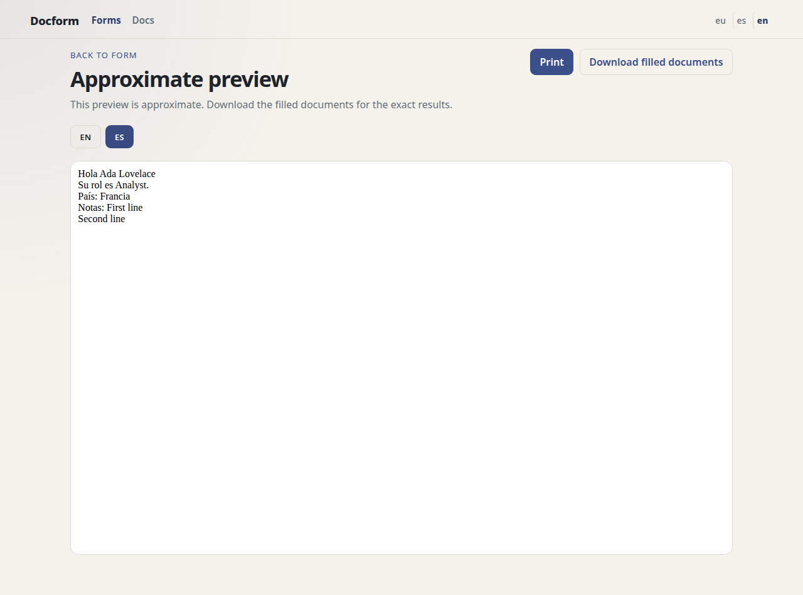

# Docform

A client-only React app that turns a set of DOCX or ODT templates containing `{{placeholders}}` into one fillable form and returns one filled document per language. The interface is available in Basque, Spanish, and English. Nothing leaves the browser.





## What it does

1. A template author creates one form from one DOCX or ODT template per language, tags each with a locale, and chooses a primary language.
2. The app validates the variant set, snapshots a shared form definition, stores every template in IndexedDB, and returns a stable route keyed by the ordered variant set.
3. A filler opens the route, fills the form once, previews any language, and downloads a ZIP containing one filled document per language.
4. The library lists forms stored in this browser, with rename, delete, and export/import of a portable `.formpack.json`.

The same variant set always resolves to the same route, and the form definition never changes under an existing route. Adding, removing, or editing a template is a new route.



## Placeholder grammar

```text
{{Label}}                       text field
{{Label|textarea}}              textarea field
{{Label[One;;Two;;Three]}}      select field
```

- `;;` separates options. Inside an option, a single `;`, a `,`, and a `|` are literal characters.
- Labels are trimmed, internal whitespace is collapsed, and identity is case-sensitive.
- Repeating the same declaration collapses to one field; declaring the same label differently is an error.
- All fields are optional. A blank answer substitutes an empty string.
- Only `text`, `textarea`, and `select` exist. An unknown modifier such as `|number` is rejected.

Placeholders are supported in the document body, tables, headers, and footers. Placeholders in text boxes, shapes, footnotes, comments, or annotations are rejected at upload.

## Multilingual forms

A form is an ordered **variant set**: one template per locale, one shared fill, one filled document per variant.

- Every variant must declare the same labels and field kinds; field order may differ.
- Select fields must declare the same number of options in every variant. Options are paired **by position**, so `Spain / France / Germany` pairs with `España / Francia / Alemania`. The detected-fields screen shows the pairing before you open the form.
- The **primary variant** supplies the labels, field order, and select options the filler sees. Choose exactly one primary at upload.
- Downloads are a ZIP named after the form, containing `<name>-<locale>-filled.<ext>` for every variant.
- Preview has one tab per locale.

The app cannot detect two option lists that happen to have the same length but different meanings. Keep the option order aligned in every template; a count mismatch fails the upload.

## Interface languages

The header has an **Interface language** switcher with Euskara, Español, and English. The choice is detected from the browser on first use, remembered in browser-local storage, and used for the chrome, validation, errors, dates, counts, and accessibility labels.

The interface locale is independent of document languages. Switching it never changes the primary variant, template labels or options, document-language tabs, form data, or generated documents. Template content is not translated. The app updates `<html lang>` for the interface and marks template-derived text with its document language where known.

Errors are reported as stable codes with structured details and localized from typed catalogs. The English diagnostic message is for development only and is never shown. Preview failures show a localized message; the raw renderer reason sits in a collapsed “Technical details” disclosure.



## Run

```bash
npm install
npm run dev
```

Build and verify:

```bash
npm run typecheck
npm run lint
npm test
npm run build
```

`npm run smoke` drives a real Chrome through the three interface languages, a bilingual upload, fill, ZIP download, English DOCX preview, and Spanish ODT preview using the system Chrome at `/usr/bin/google-chrome`. Set `CHROME_PATH` to override that executable for either smoke command. It writes screenshots and the filled ZIP to `/tmp/opencode/docform-smoke`.

## Deployment

Docform's GitHub Pages target is `https://ionlizarazu.github.io/docform/`, deployed from `main`. The first deployment requires the Pages source setting below.

- `develop` is the integration branch. Feature work merges into it.
- `develop` is promoted to `main` by pull request.
- A push to `main` runs the Pages deployment workflow.
- Pull requests targeting `main` run the `verify` check from the `CI` workflow: lint, tests, typecheck, the Pages build, the 404 artifact check, and the Pages browser smoke.

Build and smoke the Pages artifact locally:

```bash
npm run build:pages
npm run smoke:pages
```

`build:pages` builds with the `/docform/` base and writes the GitHub Pages 404 fallback. `smoke:pages` serves that artifact under `/docform/` with GitHub Pages-style 404 handling, runs the full form flow, and reloads a deep form route. Run the build before the smoke.

One-time repository setup:

1. **Settings → Pages → Build and deployment → Source: GitHub Actions**.
2. **Settings → Branches → `main` protection**: require the `verify` check from the `CI` workflow and block direct pushes.

These settings are not stored in the repository. The Pages source must be enabled before the first deployment, and branch protection is what turns the CI check into a merge gate. No `gh-pages` branch is used.

The project-site base `/docform/` is repository-specific. If the repository is renamed or a custom domain is added, change the Pages base and the router basename together.

## Storage and privacy

- Every variant template, the shared form definition, and display names live in IndexedDB under `template-form-docs`.
- There is no server, no account, no analytics, and no runtime network call for form data.
- A route only resolves in the browser profile that stored it. Clearing site data removes it.
- The Pages site is a different origin from localhost. Forms and preferences created locally do not appear on Pages, and vice versa. Use a form package to move a form between them.
- Export a `.formpack.json` to back up or move a form. Importing the same package twice is idempotent.

## Architecture

- `src/domain/` — declaration grammar, variant validation, DOCX/ODT text-node substitution, package detection, hashing, and structured error codes.
- `src/app/TemplateForms.ts` — the application service the UI consumes: variant-set ingest, list, get, rename, remove, fill, export/import.
- `src/i18n/` — interface-locale detection, typed catalogs, date/count formatting, and the error-message adapter.
- `src/storage/` — the IndexedDB store.
- `src/preview/` — a `PreviewRenderer` port with lazy `docx-preview` and `@opendocument/odr-core` adapters.
- `src/pages/` — library, form, preview, and not-found pages.

Substitution is implemented in-house on JSZip plus XML text-node editing, so the custom grammar stays authoritative and split runs/spans are handled directly. `docx-preview` and `odr-core` are used only for the approximate preview.

Preview HTML is isolated in an opaque-origin iframe (`sandbox="allow-scripts"` with no same-origin access). Document scripts and inline event handlers are stripped; the only injected script is a print bridge driven by `postMessage`.




## Limits

- DOCX and ODT only. No PDF, `.doc`, or macro-enabled `.docm`.
- No configuration editor: each template declares its own fields and options. Select options are paired positionally; there is no mapping UI.
- All fields are optional; there are no required, conditional, or computed fields.
- Preview is approximate. The downloaded documents are authoritative.
- Forms are local to one browser profile; there are no share links, accounts, or collaboration.
- The interface has three initial locales: Basque, Spanish, and English. Template content is not translated by the interface language.
- The interface language is a browser preference, not form data; it is not carried in routes or `.formpack.json` files.

## Design docs

- Specs:
  - [`.scratch/template-form/spec.md`](.scratch/template-form/spec.md)
  - [`.scratch/multilingual-interface/spec.md`](.scratch/multilingual-interface/spec.md)
  - [`.scratch/gh-pages-deployment/spec.md`](.scratch/gh-pages-deployment/spec.md)
- Glossary: [`GLOSSARY.md`](GLOSSARY.md)
- ADRs:
  - [`docs/adr/0001-inline-field-declarations.md`](docs/adr/0001-inline-field-declarations.md)
  - [`docs/adr/0002-language-variant-sets.md`](docs/adr/0002-language-variant-sets.md)
  - [`docs/adr/0003-interface-locale-and-localized-errors.md`](docs/adr/0003-interface-locale-and-localized-errors.md)
